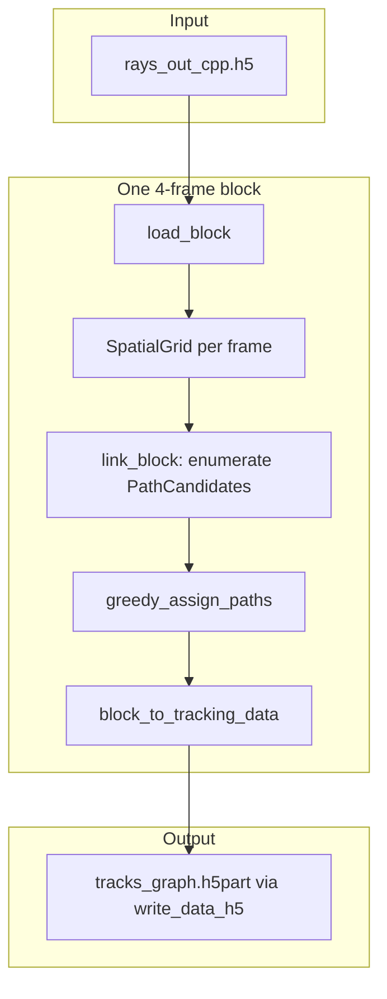
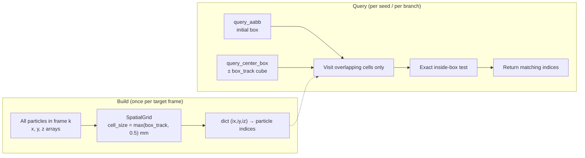
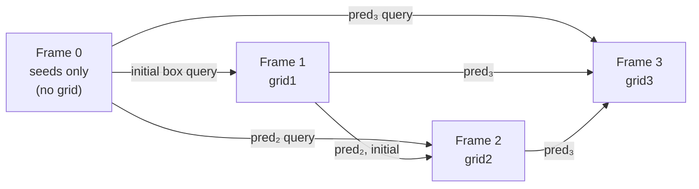
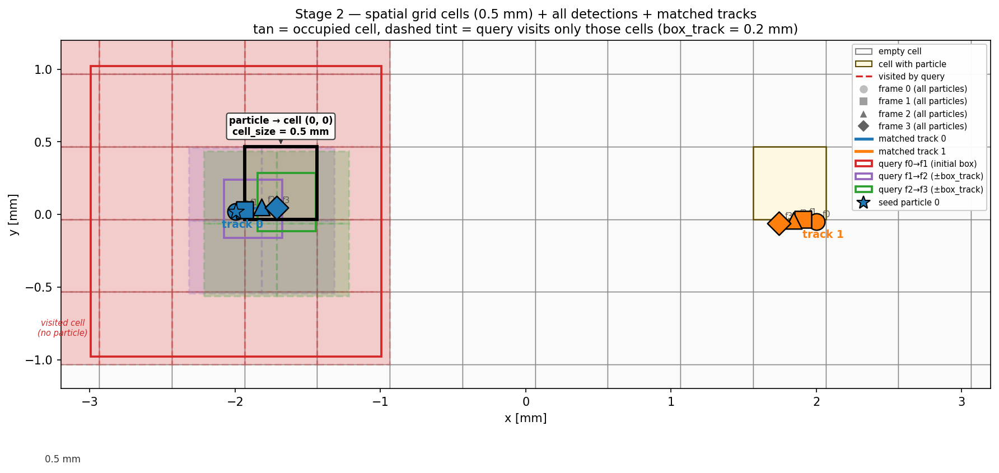
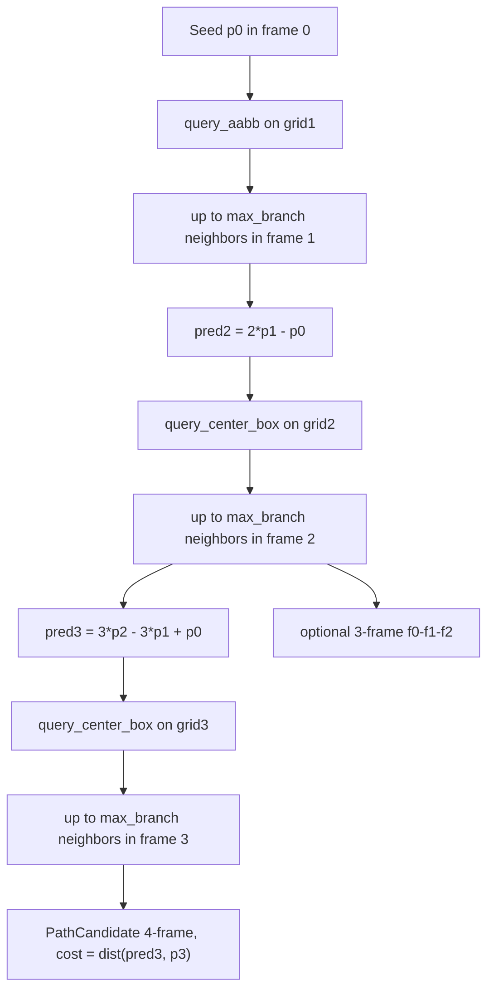

# Graph-Based 4-Frame Tracking — How It Works

This document describes the **graph tracking prototype** in `graph_tracking/`: what problem it solves, how it relates to the original 4BE-ETI linker, and how each stage of the code works in detail.

The implementation is intentionally **readable and modular** so you can modify box rules, costs, or assignment logic without navigating the legacy multi-pass state machine.

---

## Table of contents

1. [Problem and design goals](#problem-and-design-goals)
2. [High-level pipeline](#high-level-pipeline)
3. [Data model: blocks, frames, detections](#data-model-blocks-frames-detections)
4. [Input and output](#input-and-output)
5. [Stage 1 — Load a 4-frame block](#stage-1--load-a-4-frame-block)
6. [Stage 2 — Spatial indexing](#stage-2--spatial-indexing)
7. [Stage 3 — Path enumeration (the “graph” build)](#stage-3--path-enumeration-the-graph-build)
8. [Kinematics and cost function](#kinematics-and-cost-function)
9. [Stage 4 — Global assignment](#stage-4--global-assignment)
10. [Three-frame vs four-frame tracks](#three-frame-vs-four-frame-tracks)
11. [Stage 5 — Write tracks to h5part](#stage-5--write-tracks-to-h5part)
12. [Relation to “real” graph optimization](#relation-to-real-graph-optimization)
13. [Comparison with legacy 4BE-ETI](#comparison-with-legacy-4be-eti)
14. [Complexity and performance](#complexity-and-performance)
15. [Parameters reference](#parameters-reference)
16. [Source file map](#source-file-map)

---

## Problem and design goals

Particle tracking links the **same physical particle** across consecutive time steps. In this project, stereomatching produces 3D positions per camera frame, stored in `rays_out_cpp.h5`. The tracker must answer:

> For each detection in frame *t*, which detection in frame *t+1* (and *t+2*, *t+3*) is the same particle?

The legacy **4BE-ETI** implementation (`4BE-ETI/src/python_4be_eti/particle_tracking_code.py`) solves this **sequentially**:

- Loop over every particle in frames 0, 1, 2 inside a 4-frame batch.
- For each particle, enumerate candidate links using **meshgrid** searches inside axis-aligned boxes.
- Pick the **locally** cheapest path; resolve conflicts with `Count`, `CountTemp`, and `Cost` arrays.
- Order of processing matters; ties are rejected.

The **graph method** reframes linking as two global steps:

1. **Enumerate** all geometrically valid paths (candidates) in one pass.
2. **Assign** a disjoint set of paths globally (each detection used at most once per frame).

### Design goals

| Goal | How it is addressed |
|------|---------------------|
| Same physics as 4BE-ETI | Identical box gates and `predict_third_frame_position` |
| Faster on dense data | Spatial grid instead of repeated meshgrids; one linking pass |
| Better conflict handling | Global greedy assignment (not order-dependent per particle) |
| Readable code | Small modules: `load_data`, `spatial_grid`, `link_block`, `assign` |
| Optional 3-frame tracks | Paths starting at frame 0 or 1 with length 3 |

---

## High-level pipeline

Each **4-frame block** (e.g. frames 0–3, then 4–7, …) is processed **independently**, matching `FourFrameTracking` in `perform_tracking.py`.



**Pseudocode:**

```
for each block_start in [0, 4, 8, ...]:
    block = load_block(h5, block_start)           # 4 frames of (x,y,z)
    candidates = link_block(block, params)        # list[PathCandidate]
    assigned   = greedy_assign_paths(candidates)  # disjoint subset
    data       = block_to_tracking_data(block, assigned)
    write_data_h5(data, ..., min_track_length=3)
```

---

## Data model: blocks, frames, detections

### Block

A **block** is four consecutive global frame indices, e.g. `[0, 1, 2, 3]`. Blocks do not overlap:

```
Frame:  0  1  2  3 | 4  5  6  7 | 8  9 10 11 | ...
Block:  [--- 0 ---]   [--- 1 ---]   [--- 2 ---]
```

Implemented as `BlockFrames` in `load_data.py`:

- `frame_indices`: `[start, start+1, start+2, start+3]`
- `frames`: list of four `FramePositions` objects

### Frame / detection

Each `FramePositions` holds parallel arrays `x`, `y`, `z` (mm) for all stereomatched particles in that frame. Particle **local index** `i` refers to row `i` in those arrays for that frame only.

### Path candidate

A candidate track is a `PathCandidate` (`assign.py`):

```python
@dataclass
class PathCandidate:
    start_layer: int              # 0 or 1 (which frame the path starts on)
    indices: tuple[int, ...]      # length 3 or 4 — local index per frame used
    cost: float                   # lower is better
```

Example — 4-frame path starting at layer 0:

```
start_layer = 0
indices     = (i0, i1, i2, i3)   # particle i0 in frame 0, i1 in frame 1, ...
```

Example — 3-frame path starting at layer 1:

```
start_layer = 1
indices     = (i1, i2, i3)       # frames 1, 2, 3 only
```

---

## Input and output

### Input: `rays_out_cpp.h5`

Per global frame `frame00042`:

```
frame00042/
  xyze    # shape (4, n_pts): rows are x, y, z, e
  diameter, intensity, mass  # optional
```

Loaded by `load_frame()` / `load_block()` — see `load_data.py`.

### Output: `tracks_graph.h5part`

Uses the existing writer `write_data_h5()` from `4BE-ETI` (`basic_utils.py`). Each assigned path gets a **track ID** (`Count` field); unassigned detections keep `Count == 0`.

Steps are named `Step#0`, `Step#1`, … with datasets `x`, `y`, `z`, `id`, `vx`, `vy`, `vz`, `ax`, `ay`, `az`.

Graph tracking passes `min_track_length=3` so 3-frame paths are written (legacy default is 4).

---

## Stage 1 — Load a 4-frame block

**File:** `load_data.py`

```python
block = load_block(h5path, start_frame=0)
# block.frames[0] → frame 0, block.frames[1] → frame 1, ...
```

Only four frames are held in memory per block, which keeps RAM bounded when processing long recordings.

**Optional subsampling:** `LinkParams.max_seeds` limits how many frame-0 (and frame-1) particles are used as path seeds. `0` means all particles.

---

## Stage 2 — Spatial indexing

**File:** `spatial_grid.py`

### What problem it solves

For every seed particle, the tracker must ask: *which detections in the next frame could plausibly be the same particle?* That is a **neighbor search inside a 3D box**.

Legacy 4BE-ETI does this with **NumPy meshgrid**: for each seed it compares the seed’s predicted position against **every** particle in the target frame, then masks by box bounds. On Run1 that means ~42,000 seeds × ~55,000 targets × several linking steps — a lot of repeated work scanning the same frame over and over.

Stage 2 builds a **spatial index once per target frame**, then answers each query in time proportional to particles **inside the box**, not total frame size.

### Diagram — build once, query many times



Legacy meshgrid repeats the full-frame scan at every arrow into **Query**. The grid is built **once**; each query touches only the shaded cell region below.

### Diagram — 2D slice (bird's-eye view, x–y plane)

Each target frame is partitioned into **0.5 mm** cubes (when `box_track = 0.2` mm). Particles (•) are hashed into cells. A query box only visits cells it overlaps (shaded), then checks particles in those cells.

```
  y
  ^
  |   +-----+-----+-----+-----+-----+
  |   |     |  •  |     |     |     |     ← cell (ix, iy)
  |   +-----+-----+-----+-----+-----+
  |   |     |     | • • |     |     |
  |   +-----+-----+-----+-----+-----+
  |   |     |░░░░░░░░░░░|     |     |     ← shaded = cells overlapping query
  |   +-----+─░░░░░░░░░░░+-----+-----+
  |   |     |░░░[query box]░░|     |         (AABB or centered cube)
  |   +-----+─░░░░░░░░░░░+-----+-----+
  |   |  •  |░░░░░░░░░░░|  •  |     |
  |   +-----+-----+-----+-----+-----+
  +---> x

  Build:  O(N)  — insert each of N particles into one cell
  Query:  O(k)  — visit ~few cells, return k particles inside box (not all N)
```

### Diagram — three grids in a 4-frame block



Each of **grid1**, **grid2**, **grid3** is an independent `SpatialGrid` built from that frame’s detections before path enumeration (Stage 3) starts.

**Example plot** (two-particle synthetic data, particle A seed):



Regenerate with:

```bash
python scripts/plot_stage2_spatial_grid.py
```

### How `SpatialGrid` works

**Step 1 — Bin particles into cubic cells**

For frame 1 (as an example), take all `(x, y, z)` and hash each particle into a cell:

```
cell_key = ( floor((x - xmin) / cell_size),
             floor((y - ymin) / cell_size),
             floor((z - zmin) / cell_size) )
```

Cells are stored in a dictionary: `{(ix, iy, iz): [particle_indices, ...]}`.

Cell size is set in `link_block()` as `max(box_size_track, 0.5)` mm. With `box_size_track = 0.2` mm, cells are **0.5 mm** cubes — at least as wide as the search box, so each query touches only a small neighborhood of cells.

**Step 2 — Query by box**

Two query types mirror the legacy linker:

| Method | Geometry | Used when |
|--------|----------|-----------|
| `query_aabb(xlo, xhi, ylo, yhi, zlo, zhi)` | Axis-aligned rectangle (can be asymmetric) | **Initial link** frame 0→1 or 1→2 |
| `query_center_box(cx, cy, cz, half)` | Cube centered on a prediction | **Tracking links** 1→2, 2→3 |

For an AABB query, the grid computes which cell ranges overlap the box, visits only those cells, then does an exact inside-box test on each candidate particle in `spatial_grid.py`.

**Cost:** building a grid is **O(N)** for *N* particles in that frame. Each query is **O(k)** where *k* = particles in the visited cells (typically ≪ *N* in sparse flow, but *k* can be large in dense clusters).

### Why three grids, not four?

`link_block` builds grids for **frames 1, 2, and 3** only — the frames you *search into*. Frame 0 is only a seed source; you never query “find neighbors of something in frame 0.”

```
Frame:   0        1        2        3
Role:    seeds    grid1    grid2    grid3
         (no grid) (target) (target) (target)
```

This replaces legacy `meshgrid` with **O(k)** neighbor retrieval per query, where *k* is the number of particles inside the box (not total *N*).

---

## Stage 3 — Path enumeration (the “graph” build)

**File:** `link_block.py`

### What this stage produces

Stage 3 does **not** run a shortest-path or min-cost-flow solver yet. It only **lists every geometrically valid track hypothesis** as a `PathCandidate`:

```python
PathCandidate(start_layer=0, indices=(i0, i1, i2, i3), cost=0.003)
```

- `indices` — local particle index in each frame layer used
- `cost` — how far the last observed position is from the kinematic prediction (lower = smoother)
- `start_layer` — which frame the path starts on (0 or 1)

Think of it as building the **edge set** of a layered graph: each candidate is one full path through layers 0→1→2→3 (or a shorter 3-layer path).

There are three enumeration modes (controlled by `allow_3_frame`):

### A. Four-frame paths from frame 0 (primary)

**Seeds:** every particle (or subsample) in frame 0.

**Implementation:** `_paths_from_frame0()` in `link_block.py`.



For each seed `p0` at index `i0`:

**Link 0 → 1 — initial box (asymmetric gate)**

```python
p0 = (f0.x[i0], f0.y[i0], f0.z[i0])
ind1 = _query_initial_box(grid1, p0, offsets, max_branch)
```

The search region is **not** centered on `p0`. It is offset by `initial_x/y/z_lo/hi`. For Run1 that means particles must move mostly **forward in x** (0 to +3.5 mm) while y and z stay within ±1.5 mm. That matches the wind-tunnel flow direction and rejects most wrong-way links early.

```
Step 1 — frame 0 → 1  (INITIAL BOX, asymmetric)
    Find all p1 in frame 1 with:
        x1 ∈ [x0 + x_lo, x0 + x_hi]
        y1 ∈ [y0 + y_lo, y0 + y_hi]
        z1 ∈ [z0 + z_lo, z0 + z_hi]
    Cap list at max_branch candidates.
```

**Link 1 → 2 — constant-velocity prediction**

Assume uniform time between frames. If velocity is constant, position at frame 2 should be `2·p₁ − p₀`. Search a **cube** of half-width `box_size_track` (0.2 mm) around that prediction.

```
Step 2 — frame 1 → 2  (CONSTANT-VELOCITY PREDICTION)
    For each (p0, p1):
        pred2 = 2 * p1 - p0
        Find p2 in frame 2 within box_size_track of pred2.
```

**Link 2 → 3 — quadratic prediction**

With three positions you can fit a quadratic in time. The extrapolated position at frame 3 is `3·p₂ − 3·p₁ + p₀` — same formula as legacy 4BE-ETI (`predict_third_frame_position`).

```
Step 3 — frame 2 → 3  (QUADRATIC PREDICTION)
    For each (p0, p1, p2):
        pred3 = 3*p2 - 3*p1 + p0
        Find p3 in frame 3 within box_size_track of pred3.
        cost  = ||pred3 - p3||       # Euclidean distance (mm)
        Add PathCandidate(start_layer=0, indices=(i0,i1,i2,i3), cost)
```

Cost is only the **final prediction error** ‖pred₃ − p₃‖. Earlier steps act as gates, not separate cost terms.

**Optional 3-frame branch (same seed, earlier stop)**

If `allow_3_frame`, every valid `(p0, p1, p2)` prefix also emits a shorter candidate:

```
cost2 = ||pred2 - p2||
PathCandidate(start_layer=0, indices=(i0, i1, i2), cost=cost2)
```

One physical particle can generate **both** a 3-frame and a 4-frame candidate from the same prefix. Stage 4 (assignment) later picks which survive when they conflict.

### B. Three-frame paths from frame 1

**Seeds:** every particle (or subsample) in frame 1.

**Implementation:** `_paths_from_frame1()` in `link_block.py`.

Handles particles **not visible in frame 0** but appearing in frame 1:

For each seed `p1` at index `i1`:

```
Step 1 — frame 1 → 2  (INITIAL BOX applied from p1)
    Same offset rules as frame 0→1, but anchored at p1.

Step 2 — frame 2 → 3  (CONSTANT-VELOCITY from p1, p2)
    pred3 = 2 * p2 - p1
    Find p3 near pred3; cost = ||pred3 - p3||
    PathCandidate(start_layer=1, indices=(i1, i2, i3), cost)
```

On Run1 this second pass uses ~55k frame-1 seeds and contributes a large share of total candidates even when 4-frame paths alone would suffice.

### Branch cap: `max_branch`

The enumeration is a **depth-first tree** with branching at each link:

\[
N_{\text{seeds}} \times k_1 \times k_2 \times k_3 \quad \text{(worst case)}
\]

where each \(k_i \leq\) `max_branch` (default 30).

At each branching step, only the **first** `max_branch` spatial-query results are kept (in grid iteration order). This mirrors `MAX_CANDIDATES_MESH` in legacy code and prevents combinatorial explosion in dense regions.

### Path-dependent branching

Unlike a simple bipartite graph between adjacent frames, predictions depend on **the full prefix**:

- The gate for `p2` depends on `(p0, p1)`.
- The gate for `p3` depends on `(p0, p1, p2)`.

This is not a simple bipartite graph between adjacent frames — it is a **hypergraph** of full paths. Spatial indexing makes each individual query fast; it does **not** reduce the branching factor itself.

### Concrete miniature example

Two particles approaching in x (synthetic test):

```
Frame 0:  A at x=0,   B at x=3
Frame 1:  A at x=0.1, B at x=3.08
Frame 2:  A at x=0.21, B at x=3.17
Frame 3:  A at x=0.33, B at x=3.29
```

For seed A (index 0):

- Initial box from x=0 finds only A in frame 1 (B is too far in x)
- pred₂ lands near A’s true frame-2 position → one neighbor
- pred₃ lands near A’s true frame-3 position → one neighbor
- One 4-frame candidate: `(0,0,0,0)` with small cost

B gets its own parallel branch from seed index 1. Wrong cross-links fail the initial x gate or miss the 0.2 mm tracking box.

### Bidirectional graph (`use_bidirectional_graph`)

When enabled, Stage 3 runs **two** enumerations on the same 4-frame block, then merges their candidate lists before Stage 4 assignment.

**Forward pass** (unchanged): seeds **frame 0**, walks f0 → f1 → f2 → f3 with the normal initial box offsets.

**Backward pass**: seeds **frame 3**, walks backward in time with **flipped** initial-box signs (search opposite flow direction):

```
f3 → f2   initial box with flipped offset signs  ([-x_hi, -x_lo] vs forward)
f2 → f1   pred₁ = 2·p₂ − p₃
f1 → f0   pred₀ = 3·p₁ − 3·p₂ + p₃
```

Three-frame paths from frame 1 are **not** enumerated in this mode (`allow_3_frame` is effectively forward-only 4-frame + backward 4-frame).

#### Combining forward and backward into one graph

**File:** `assign.py` — `combine_bidirectional_four_frame()`

Both passes emit 4-frame `PathCandidate` objects with the same index tuple `(i₀, i₁, i₂, i₃)` but **different endpoint costs** (see [Kinematics and cost function](#kinematics-and-cost-function)). The merge builds one assignment graph:

| Candidate source | Combined cost |
|------------------|---------------|
| Index tuple in **both** passes | `cost = cost_forward + cost_backward` |
| **Forward-only** tuple | `cost = cost_forward` (endpoint error at frame 3) |
| **Backward-only** tuple | `cost = cost_backward` (endpoint error at frame 0) |

Paths validated in both directions therefore carry the **sum** of forward and backward prediction errors. Greedy assignment (`greedy_assign_paths`) then picks a **single** disjoint set on this merged list — it does **not** assign forward and backward separately and intersect results.

**Intuition:** A path that fits kinematics well in both time directions tends to have a lower combined cost than a path that only fits one direction, but forward-only or backward-only candidates can still win if they are cheap enough and avoid detection conflicts.

CLI: `--use-bidirectional-graph` on `run_tracking.py` (`--bidirectional` is an alias), or `LinkParams(use_bidirectional_graph=True)`.

### What Stage 3 outputs

`link_block()` returns a `BlockResult` with candidates and stats (`n_bidirectional_4frame`, `n_forward_only_4frame`, `n_backward_only_4frame`, … when bidirectional graph mode is on).

### How stages 2 and 3 fit together

```
For each 4-frame block:
  1. Build SpatialGrid for frames 1, 2, 3     ← Stage 2 (once per frame)
  2. For each seed in frame 0:
       query grid1 → branch
       for each hit: query grid2 → branch
         for each hit: query grid3 → branch
         emit PathCandidates                    ← Stage 3
  3. (optional) Repeat with seeds in frame 1 for 3-frame f1→f3 paths
```

Stage 2 is the **performance optimization** (fast neighbor lookup).  
Stage 3 is the **physics + combinatorics** (same gates as legacy, but enumerate all valid paths up front instead of committing one-by-one).

---

## Kinematics and cost function

**File:** `kinematics.py` (matches `4BE-ETI/particle_tracking_code.py`)

### Constant-velocity step (one frame ahead)

Uniform time step \(\Delta t\). Position at \(n+2\) from samples at \(n\) and \(n+1\):

\[
\hat{p}_{n+2} = 2 p_{n+1} - p_n
\]

Implemented as `2.0 * p1 - p0` per axis.

### Quadratic extrapolation (two frames ahead)

Three samples at \(n, n+1, n+2\) define a unique quadratic; position at \(n+3\):

\[
\hat{p}_{n+3} = 3 p_{n+2} - 3 p_{n+1} + p_n
\]

This is equivalent to the Taylor step used in 4BE-ETI with \(\Delta t = 1\).

### Cost

For **4-frame** candidates from the **forward** pass, cost is the **final prediction error** at frame 3:

\[
\text{cost}_\text{fwd} = \|\hat{p}_3 - p_3\|_2, \quad \hat{p}_3 = 3 p_2 - 3 p_1 + p_0
\]

For **4-frame** candidates from the **backward** pass, cost is the **first-frame prediction error** at frame 0:

\[
\text{cost}_\text{bwd} = \|\hat{p}_0 - p_0\|_2, \quad \hat{p}_0 = 3 p_1 - 3 p_2 + p_3
\]

Intermediate backward steps use the mirrored constant-velocity prediction at frame 1:

\[
\hat{p}_1 = 2 p_2 - p_3
\]

When `use_bidirectional_graph` is on and the same index tuple appears in both passes, the merged candidate uses:

\[
\text{cost} = \text{cost}_\text{fwd} + \text{cost}_\text{bwd}
\]

There is **no separate weight** on acceleration magnitude or direction — only these endpoint position errors (and their sum for bidirectional paths). Assignment ranks candidates by **ascending cost** (after preferring longer paths).

For **3-frame** candidates ending at frame 2 (from frame 0):

\[
\text{cost} = \|\hat{p}_2 - p_2\|_2, \quad \hat{p}_2 = 2p_1 - p_0
\]

For **3-frame** candidates ending at frame 3 (from frame 1):

\[
\text{cost} = \|\hat{p}_3 - p_3\|_2, \quad \hat{p}_3 = 2p_2 - p_1
\]

Lower cost means the observed position is closer to the kinematic prediction (smoother motion).

---

## Stage 4 — Global assignment

**File:** `assign.py` — `greedy_assign_paths()`

After enumeration, many candidates **share detections** (two paths cannot both be true if they use the same particle in the same frame). The assignment problem:

> Choose a set of paths such that each detection index is used **at most once per frame layer**, optimizing path quality.

### Current algorithm: greedy disjoint selection

This is **not** full min-cost flow (yet), but it is **global** unlike legacy per-particle linking:

1. Sort all candidates by:
   - **Descending path length** (prefer 4-frame over 3-frame)
   - **Ascending cost** (prefer smoother paths)
2. Iterate sorted list; accept a candidate if **none** of its `(layer, index)` pairs are already used.
3. Mark those detections as used.

```python
used = [set(), set(), set(), set()]  # one set per frame layer 0..3

for candidate in sorted_candidates:
    if any index already used on that layer:
        skip
    else:
        accept candidate; mark indices used
```

### Constraint interpretation

Think of four **layers** (frame 0, 1, 2, 3). Each detection in a layer is a **node** with capacity 1. Each `PathCandidate` is a **hyperedge** connecting one node per layer it spans. The greedy procedure approximates **maximum weight set packing** with weights \(-\text{cost}\) and a length bonus.

### Why not single shortest path?

A DAG shortest-path algorithm finds **one** path from source to sink. Here we need **thousands** of vertex-disjoint paths across shared layers — that requires **multi-commodity flow**, **min-cost matching**, or enumeration + assignment as implemented here.

---

## Three-frame vs four-frame tracks

| Type | Frames | `start_layer` | When useful |
|------|--------|---------------|-------------|
| 4-frame | f0–f3 | 0 | Standard track; B-spline velocities |
| 3-frame | f0–f2 | 0 | Particle lost / missing in frame 3 |
| 3-frame | f1–f3 | 1 | Particle not detected in frame 0 |

Enable/disable via `LinkParams.allow_3_frame` or CLI `--no-3-frame`.

Assignment **prefers 4-frame** paths when both compete for the same detections.

---

## Stage 5 — Write tracks to h5part

**File:** `track_data.py`

`block_to_tracking_data()` fills a `basic_utils.a` object:

- Concatenates all particles from four frames into flat arrays.
- Sets `Count[flat_index] = track_id` for each assigned detection.
- Unassigned particles remain `Count == 0`.

Track IDs are offset when merging multiple blocks into one h5part file (`run_tracking.py`).

`write_data_h5()` then:

- Filters tracks with fewer than `min_track_length` frames (default 3 for graph).
- Computes velocities/accelerations (B-spline if `use_bspline=True` and 4 points exist).
- Appends `Step#N` groups to the h5part file.

---

## Relation to “real” graph optimization

The name **graph tracking** reflects the conceptual model (layers, edges, costs). The current prototype implements:

| Concept | Implementation |
|---------|----------------|
| Nodes | Detections per frame layer |
| Edges | Valid box connections along a path prefix |
| Edge cost | Prediction error at path endpoint |
| Capacity 1 per node | Enforced in `greedy_assign_paths` |
| Optimal global solution | **Approximated** by greedy sort |

A future upgrade could replace greedy assignment with **min-cost max-flow** on a 4-layer network without changing enumeration or box rules. GPU acceleration would help most in **edge/cost construction** (Stage 3), not the assignment solve at current scales.

---

## Comparison with legacy 4BE-ETI

Measured on **TNTI Run1**, frames 0–3 (~42k–57k detections/frame), same box parameters:

| Metric | Graph | Legacy |
|--------|-------|--------|
| Runtime | ~40 s | ~373 s |
| 4-frame tracks | 5,797 | 5,795 |
| Matched (identical positions) | 5,790 | |
| Graph-only | 7 | |
| Legacy-only | 5 | |

Differences come from:

1. **Global vs sequential** assignment (order effects in legacy).
2. **`max_branch` truncation** — same role as `MAX_CANDIDATES_MESH`.
3. Legacy **rejects ties**; graph keeps one path via global ordering.

Matched tracks have **0 mm** position error by construction (same detections selected).

### What legacy does differently

| Aspect | Legacy | Graph |
|--------|--------|-------|
| Passes per block | 3 frame steps × all particles | 1 enumeration + 1 assign |
| Neighbor search | Meshgrid per particle | Spatial grid per frame |
| Conflict resolution | `Count` / `CountTemp` / `Cost` | Greedy global |
| 3-frame tracks | No | Optional |
| Numba | `no_previous_tracks_3d` only | Pure NumPy |

---

## Complexity and performance

Per block, with \(N\) frame-0 seeds and average branch factor \(k\) per stage:

| Stage | Approximate cost |
|-------|------------------|
| Load 4 frames | O(total detections in block) |
| Build 3 spatial grids | O(N₀ + N₁ + N₂ + N₃) |
| Enumerate paths | O(N × k₁ × k₂ × k₃) worst case, capped by `max_branch` |
| Greedy assign | O(C log C) where C = number of candidates |
| Write h5part | O(assigned particles) |

**Memory:** candidate list size dominates; dense scenes with large `max_branch` can produce millions of `PathCandidate` objects.

**Progress output:** `progress_interval` (default 5000) prints seed/particle progress — see `progress.py`.

---

## Parameters reference

Defined in `LinkParams` (`link_block.py`):

| Parameter | Default (Run1) | Meaning |
|-----------|----------------|---------|
| `box_size_track` | 0.2 mm | Half-width of cube around predicted position (frames 1→2, 2→3, etc.) |
| `initial_x_lo`, `initial_x_hi` | 0, 3.5 | Frame *n* → *n+1* x search offsets from seed (asymmetric forward gate) |
| `initial_y_lo`, `initial_y_hi` | ±1.5 | y initial box |
| `initial_z_lo`, `initial_z_hi` | ±1.5 | z initial box |
| `max_branch` | 30 | Max candidates per branching step |
| `max_seeds` | 0 (all) | Subsample frame-0 / frame-1 seeds; 0 = no limit |
| `allow_3_frame` | True | Include 3-frame path types |
| `use_bidirectional_graph` | False | Merge forward + backward 4-frame candidates before assignment; disables frame-1 3-frame seeds |
| `progress_interval` | 5000 | Progress print frequency; 0 = quiet |
| `seed_rng` | 0 | RNG seed when subsampling seeds |

CLI wrappers: `run_tracking.py`, `test_compare_graph_legacy.py`.

---

## Source file map

| File | Responsibility |
|------|----------------|
| `load_data.py` | Read `rays_out_cpp.h5`; `BlockFrames`, `FramePositions` |
| `spatial_grid.py` | Uniform grid; AABB and center-box queries |
| `kinematics.py` | Prediction formulas and distance cost |
| `link_block.py` | Enumerate `PathCandidate` list for one block |
| `assign.py` | `PathCandidate`, `combine_bidirectional_four_frame`, `greedy_assign_paths` |
| `track_data.py` | Build `basic_utils.a` for h5part export |
| `progress.py` | Stdout progress helpers |
| `compare.py` | Side-by-side benchmark vs legacy |
| `run_tracking.py` | Production-style CLI for full runs |
| `synthetic/two_particles.py` | Tiny test dataset generator |

---

## Quick start

```bash
# One block, Run1 data, with progress
python graph_tracking/run_tracking.py \
  --input data/.../Run1/rays_out_cpp.h5 \
  --output-dir data/.../Run1 \
  --max-blocks 1

# Compare graph vs legacy on one block
python graph_tracking/test_compare_graph_legacy.py --no-3-frame

# Interactive / Jupyter-style
# Open scripts/test_graph_tracking.py and run cells
```

For algorithm questions or changes, start with `link_block.py` (geometry) and `assign.py` (which paths survive).
